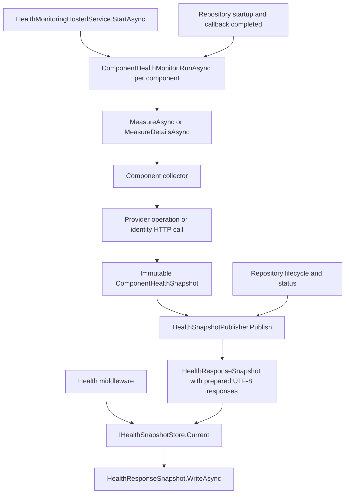

# Health monitoring for developers

Health monitoring has three stages: background collection, snapshot publication, and HTTP delivery. Active database, blob, search and identity operations belong to collection. Publication prepares the complete response, including JSON serialization. The `/health` request selects and writes an existing response.

This guide maps those stages to their implementation and identifies the call sites to use when changing or debugging a measurement. See [Health endpoint](health.md) for the response contract, middleware setup, permissions and configuration defaults. Source links below point to the current implementation; method names remain useful navigation targets if line numbers change.

## Execution flow



[ServicesExtensions](../src/Services.Core/ServicesExtensions.cs#L156) registers the four collectors, publisher and access evaluator as singletons. The health hosted service is registered after `RepositoryHostedService`. Its constructor validates that there is exactly one collector named `Database`, `BlobStorage`, `Search` and `Identity`.

[HealthMonitoringHostedService.StartAsync](../src/Services.Core/Diagnostics/HealthMonitoringHostedService.cs#L42) publishes an initial snapshot and starts a worker for each component, a publication loop, and a Developers group resolution loop. These workers start once per host and run without incoming health requests. The monitors wait for the readiness flag set by [RepositoryHostedService.StartAsync](../src/Services.Core/RepositoryHostedService.cs#L75) after repository initialization and the startup callback complete.

## Common measurement call sites

| Stage | Call site | Responsibility |
| --- | --- | --- |
| Schedule a component | [ComponentHealthMonitor.RunAsync](../src/Services.Core/Diagnostics/ComponentHealthMonitor.cs#L45) | Waits for readiness, applies initial jitter, runs status then due details collection, and delays until the next cycle. |
| Invoke a status collector | [ComponentHealthMonitor.MeasureAsync, line 78](../src/Services.Core/Diagnostics/ComponentHealthMonitor.cs#L78) | Calls `_collector.CollectAsync(cancel)`, validates the result, copies its fields and records measurement timestamps. |
| Invoke a details collector | [ComponentHealthMonitor.MeasureDetailsAsync, line 111](../src/Services.Core/Diagnostics/ComponentHealthMonitor.cs#L111) | Calls `IComponentHealthDetailsCollector.CollectDetailsAsync(cancel)`, sanitizes and serializes the returned data. |
| Enforce operation limits | [ComponentHealthMonitor.ExecuteAsync](../src/Services.Core/Diagnostics/ComponentHealthMonitor.cs#L122) | Runs the operation in a task, enforces its timeout and keeps the component occupied until a timed-out operation actually finishes. |
| Create the operation scope | [ScopedHealthCollector.CollectAsync and CollectDetailsAsync](../src/Services.Core/Diagnostics/HealthCollectors.cs#L31) | Creates a DI scope and a `SystemAccount`, then dispatches to the component-specific implementation. The scope lives until that operation completes. |

The default status interval is 10 seconds for Database, BlobStorage and Search, and 30 seconds for Identity. Details normally run every five minutes. These are delays after a completed cycle, with jitter; they are not fixed wall-clock schedules. Status and details operations for the same component run sequentially. Different components run independently.

## Component measurement call sites

The following table identifies the calls that perform the actual status measurements. All four are in [HealthCollectors.cs](../src/Services.Core/Diagnostics/HealthCollectors.cs).

| Component | Collector call site | Operation |
| --- | --- | --- |
| Database | [DatabaseHealthCollector.CollectAsync, line 54](../src/Services.Core/Diagnostics/HealthCollectors.cs#L54) | Resolves `DataProvider` and calls `GetHealthAsync(cancel)`. |
| BlobStorage | [BlobStorageHealthCollector.CollectAsync, line 77](../src/Services.Core/Diagnostics/HealthCollectors.cs#L77) | Resolves `IBlobStorage` and calls `GetHealthAsync(cancel)`. |
| Search | [SearchHealthCollector.CollectAsync, line 100](../src/Services.Core/Diagnostics/HealthCollectors.cs#L100) | Calls `Providers.Instance.SearchEngine.IndexingEngine.ReadActivityStatusFromIndexAsync(cancel)`. |
| Identity | [IdentityHealthCollector.CollectAsync, lines 158 and 159](../src/Services.Core/Diagnostics/HealthCollectors.cs#L158) | Calls `HttpClient.GetAsync(url, cancel)` and reads the discovery response using `ReadAsStringAsync(cancel)`. |

### Database

The provider contract is [DataProvider.GetHealthAsync](../src/Storage/Data/DataProvider.cs#L965). With SQL storage, the implementation is [MsSqlDataProvider.GetHealthAsync](../src/ContentRepository.MsSql/MsSqlDataProvider.cs#L413). Its database call is `ctx.ExecuteScalarAsync(sql)` at [line 424](../src/ContentRepository.MsSql/MsSqlDataProvider.cs#L424), using a context created with the collection cancellation token. The query is:

```sql
SELECT Path FROM Nodes WHERE NodeId = 1
```

The provider returns green for a non-null result, yellow for a null or `DBNull` result, and red when the operation throws. `ResponseTime` measures the provider operation; it is not the HTTP endpoint's response time.

[InMemoryDataProvider.GetHealthAsync](../src/ContentRepository.InMemory/InMemoryDataProvider.cs#L2126) is a separate implementation that returns a green result without external I/O. In-memory tests therefore do not verify SQL connectivity.

### BlobStorage

[BlobStorage.GetHealthAsync](../src/BlobStorage/Data/BlobStorage.cs#L452) performs two operations:

1. [Line 461](../src/BlobStorage/Data/BlobStorage.cs#L461): `DataProvider.GetFirstFileIdAsync(cancel)` obtains the first file ID from the blob metadata provider.
2. [Line 462](../src/BlobStorage/Data/BlobStorage.cs#L462): `GetBlobStorageContextAsync(fileId, cancel)` obtains its storage context. The overload chain delegates to the metadata provider at [line 151](../src/BlobStorage/Data/BlobStorage.cs#L151).

The SQL implementation of the first operation is [MsSqlBlobMetaDataProvider.GetFirstFileIdAsync](../src/BlobStorage/Data/MsSqlClient/MsSqlBlobMetaDataProvider.cs#L660). The resulting context determines the color: green for a context, yellow for no context, and red for an exception. This check exercises metadata access; it does not read or write the external blob's bytes.

### Search

The collector calls [IIndexingEngine.ReadActivityStatusFromIndexAsync](../src/Search/Indexing/IIndexingEngine.cs#L75) on the configured search engine. A non-null activity status is green; null is yellow. An exception is handled by the common monitor as a failed measurement.

For in-memory search, [InMemoryIndexingEngine.ReadActivityStatusFromIndexAsync](../src/ContentRepository.InMemory/InMemoryIndexingEngine.cs#L61) delegates to `Index.ReadActivityStatus()`. Local Lucene and centralized search use the implementation supplied by their configured provider package. To debug the remote operation, step into that provider from the collector call at line 100.

The collector does not call `ISearchEngine.GetHealthAsync`. Changing that older method alone does not change this endpoint's Search measurement. Search client/server configuration comparison is a separate details operation, described below.

### Identity

[IdentityHealthCollector.CollectAsync](../src/Services.Core/Diagnostics/HealthCollectors.cs#L142) reads authentication options and selects `MetadataHost` when configured, otherwise `Authority`. It appends `/.well-known/openid-configuration` and uses the named client `SenseNet.Health.Identity` from `IHttpClientFactory`. The response buffer is limited to 128 KiB.

The measurement is green when the response is HTTP 200 and its text contains both `scopes_supported` and `sensenet`; otherwise it is yellow. This is a discovery-response check, not a login or token-validation test. Transport exceptions and timeouts are handled by the common monitor.

`InternalOnly` local authentication, or an application with neither authentication schemes nor an authority, produces the green `NotApplicable` state without making an HTTP call. If external authentication is expected but no authority can be selected, the collector reports `Missing`.

## Diagnostic details call sites

Details collection runs after the component's status measurement when due, using the same component slot and a separate timeout. It is skipped for `NotApplicable`. The data is returned as `HealthDetailsResult`, copied into JSON by the monitor, and later exposed under `Details.<Component>`.

| Component | Details entry point | Calls and data |
| --- | --- | --- |
| Database | [DatabaseHealthCollector.DetailsAsync, line 55](../src/Services.Core/Diagnostics/HealthCollectors.cs#L55) | Collects provider type names, calls `DataProvider.CreateSchemaWriter()` for its type, and calls `DataProvider.GetConfigurationForHealthDashboard()` at line 68. |
| BlobStorage | [BlobStorageHealthCollector.DetailsAsync, line 78](../src/Services.Core/Diagnostics/HealthCollectors.cs#L78) | Collects provider type names and `IBlobProviderStore.Keys`; calls `IBlobStorage.GetConfigurationForHealthDashboard()` at line 88. |
| Search | [SearchHealthCollector.DetailsAsync, line 108](../src/Services.Core/Diagnostics/HealthCollectors.cs#L108) | Calls `ISearchEngine.GetConfigurationForHealthDashboard()` at line 111, records indexing/query engine types, and calls `Compare` at line 112. Configuration retrieval may involve the remote search provider. |
| Identity | [IdentityHealthCollector.DetailsAsync, line 168](../src/Services.Core/Diagnostics/HealthCollectors.cs#L168) | Reads `Authority`, `ClientApplicationUrl`, `AddJwtCookie` and `MetadataHost` from options. This operation makes no discovery request. |

[SearchHealthCollector.Compare](../src/Services.Core/Diagnostics/HealthCollectors.cs#L119) runs only for a centralized index. It compares the returned `SearchService_Security_ConnectionString`, `SearchService_RabbitMq_ServiceUrl` and `SearchService_RabbitMq_MessageExchange` values with the current security configuration. Missing configuration or different values make the details result red; the reason lists differing keys without their values. This comparison contributes to the effective Search color even when the status probe succeeds.

[HealthDataSanitizer](../src/Services.Core/Diagnostics/HealthDataSanitizer.cs) masks sensitive property names and recognizable credentials in text before publication. Collectors must still omit secrets and return bounded data: sanitization is a secondary safeguard, and arbitrary object graphs are serialized before they can be sanitized.

## Snapshot publication and HTTP delivery

[ComponentHealthMonitor.Publish](../src/Services.Core/Diagnostics/ComponentHealthMonitor.cs#L39) atomically replaces the component's immutable snapshot and signals the publication loop. [HealthMonitoringHostedService.PublishAsync](../src/Services.Core/Diagnostics/HealthMonitoringHostedService.cs#L56) waits for a signal or the configured `PublishInterval` before its next publication attempt.

[HealthSnapshotPublisher.Publish](../src/Services.Core/Diagnostics/HealthSnapshotPublisher.cs#L51) reads completed component snapshots, applies freshness rules, copies repository status/history, and derives the overall color. It creates a `HealthResponseSnapshot` before replacing `IHealthSnapshotStore.Current`. A publication sequence and compare/exchange prevent an older, slower publication from replacing a newer one, including a shutdown snapshot.

The [HealthResponseSnapshot constructor](../src/Services.Core/Diagnostics/HealthSnapshots.cs#L101) serializes four UTF-8 responses: public, detailed, expired public, and expired detailed. The public DTO explicitly contains only the overall color and the four component colors. Adding a diagnostic field cannot implicitly expose it through the public DTO.

The two HTTP branches use the same store:

- [HealthEarlyMiddleware.InvokeAsync](../src/Services.Core/Diagnostics/HealthEarlyMiddleware.cs#L17) serves anonymous requests and the recognized dedicated health key before repository-dependent middleware. Ordinary credentials continue to normal authentication when the repository is ready.
- [HealthMiddleware.InvokeAsync](../src/Services.Core/Diagnostics/HealthMiddleware.cs#L10) asks `IHealthAccessEvaluator` which response is visible, then calls the snapshot's writer.

[HealthResponseSnapshot.WriteAsync](../src/Services.Core/Diagnostics/HealthSnapshots.cs#L119) checks publication expiry using the monotonic clock, selects a prepared byte array, sets response headers and writes it. It does not call collectors, providers or a JSON serializer. The HTTP request still has normal CPU/network costs, and the authenticated branch retains the cost of normal authentication.

[HealthAccessEvaluator.CanReadDetails](../src/Services.Core/Diagnostics/HealthAccessEvaluator.cs#L29) uses the authenticated user captured in [UseSenseNetUser](../src/Services.Core/IdentityExtensions.cs#L140), before later middleware can elevate `User.Current`. It grants details to `HealthCheckerUser`, Administrators and Developers, including indirect membership. The Developers group ID is resolved by [RefreshDeveloperGroup](../src/Services.Core/Diagnostics/HealthAccessEvaluator.cs#L46) in the hosted service's background loop and stored with cache dependencies; the request does not resolve its repository path.

`IHealthHandler.GetHealthResponseAsync` is a compatibility API that parses a detached object from cached JSON. The HTTP middleware does not use it. Replace or extend collectors to change measurement behavior; overriding `IHealthHandler` alone no longer changes the endpoint.

## Failure and concurrency rules

- Each component has at most one active status or details operation. `ExecuteAsync` also isolates provider code that blocks synchronously before returning a task. These tasks use the shared thread pool, not dedicated threads.
- On a status timeout, the monitor publishes `TimedOut` and red, requests cancellation, and waits for the original operation to finish before starting another operation for that component. A late result is discarded. A details timeout records a details error; it does not replace the status measurement state.
- A completed `HealthResult` produces `State = Available` even if its color is yellow or red. `LastSuccessAtUtc` advances only for a green status result. The final published color can still be worse because of details or freshness.
- Expired status measurements are red. Missing, failed or expired details raise the component to at least yellow; a red details result raises it to red. Details failures retain the last collected data with its timestamps and error.
- Publication lifetime is bounded by `PublisherMaxAge` and the nearest relevant expiry. When it expires, the writer uses the prepared fallback with all colors red. It never attempts a refresh in the request.
- Startup failure and shutdown make the overall color red. Startup grace, measurement age and publication age use `TimeProvider` monotonic elapsed time. UTC timestamps describe the results for clients.

## Changing a collector

The public contracts are [IComponentHealthCollector and IComponentHealthDetailsCollector](../src/Services.Core/Diagnostics/HealthSnapshots.cs#L39). `CollectAsync` returns a `SenseNet.Diagnostics.HealthResult` with color, optional response time, reason and method. Implement `CollectDetailsAsync` only when additional diagnostics are needed; its result can also contribute a color and reason.

For a change to an existing built-in component, keep its exact `ComponentName` and replace the corresponding singleton registration in [ServicesExtensions](../src/Services.Core/ServicesExtensions.cs#L163). Do not append a second collector with the same name. The built-in collector classes are internal; consumers outside this assembly implement the public interfaces rather than inheriting those classes.

Collectors must pass cancellation tokens to I/O, avoid unbounded retries, and return detached data. Singleton collectors should create an operation scope for scoped services, as `ScopedHealthCollector` does. Keep expensive configuration retrieval in details collection. Never add provider calls to `Current` getters, access checks, response serialization or middleware callbacks.

Adding a fifth component requires changes to the fixed component list, options mapping, public response DTO, collector registrations and tests. Registering another collector alone is rejected by the hosted service.

## Debugging and tests

To follow one measurement, set breakpoints at `ComponentHealthMonitor.MeasureAsync`, the relevant collector call in the component table, and `HealthSnapshotPublisher.Publish`. For diagnostic configuration issues, use `MeasureDetailsAsync` and the component's `DetailsAsync` instead. Sending `/health` repeatedly should not increase collector invocation counts.

For a stale response, inspect `CheckedAtUtc`, `ValidUntilUtc`, the details timestamps and `Details.<Component>.Error` with diagnostic access. Check whether a previous provider operation is still occupying its component slot. A red expiry fallback with `SnapshotExpired` indicates that no currently valid publication is available; the detailed reason distinguishes it from a normal probe result.

The regression tests are in [HealthTests.cs](../src/Tests/SenseNet.Services.Core.Tests/HealthTests.cs) and [HealthAccessTests.cs](../src/Tests/SenseNet.Services.Core.Tests/HealthAccessTests.cs). They cover request isolation, timeouts, late results, independent components, immutable snapshots, expiry, concurrent publication, startup/shutdown, credential redaction and access control. [HealthTestClock](../src/Tests/SenseNet.Services.Core.Tests/HealthTestClock.cs) provides deterministic timer and elapsed-time control.

Run the health tests from the repository root:

```powershell
dotnet test src/Tests/SenseNet.Services.Core.Tests/SenseNet.Services.Core.Tests.csproj --filter "FullyQualifiedName~Health"
```

When changing a provider probe, also verify the behavior against that provider. The in-memory suite does not exercise a real SQL server, remote search service or identity server.
